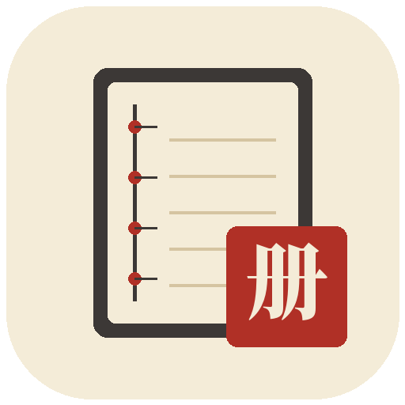

<h1 align="center">Folio</h1>

<p align="center">
  
</p>

<p align="center">
  <strong>A paper-reading desk for agentic work.</strong><br />
  Keep the chat beside the page. Explain or translate a paragraph in place.<br />
  Use Claude Code, Codex, Cursor, OpenCode, and Gemini on a server you control.
</p>

<div align="center">

[](LICENSE)
[](CONTRIBUTING.md)
[](server/README.md)

</div>

## What Folio is

Folio is a desktop workspace for reading papers and driving coding agents in
the same window. Open a PDF folder, select a passage, and ask the connected
agent — or translate the passage without leaving the page.

Behind the desktop sits **AgentsServer**, a self-hosted backend that runs your
agent CLIs, stores chat history, and owns the project files. Folio connects to
that server from the same machine or another device on your network / Tailscale.

This repository continues the AgentsDock client/server architecture with
Folio’s paper-reading desk and desktop branding.

## Install

Folio has two parts:

1. **AgentsServer** — runs agents and holds workspaces (required).
2. **Folio desktop** — the Electron app you use day to day.

There is no published Folio binary release yet. Install the server from npm,
then build and run the desktop from this source tree.

### 1. Prepare the server machine

Use **Linux** or an **Apple silicon Mac**. Native Windows server installation is
not supported (the Windows desktop can still connect to a supported host).

| Prerequisite | Notes |
| --- | --- |
| Node.js **22.14+** and npm | [Download](https://nodejs.org/en/download) |
| [`uv`](https://docs.astral.sh/uv/getting-started/installation/) | Prepares the server’s Python runtime |
| `tmux` | Needed for persistent terminals and managed updates; basic chats work without it |

On macOS with Homebrew:

```sh
brew install node uv tmux
```

On Linux, install Node.js and `uv` from their guides, and install `tmux` from
your distribution. AgentsServer needs Python 3.11 or newer; `uv` supplies it.
Confirm in the same terminal:

```sh
node --version
npm --version
uv --version
tmux -V
```

Client-only devices do not need these prerequisites.

### 2. Install AgentsServer

On the machine that will run your agents, as the server owner, **without**
`sudo`:

```sh
npm install -g agentsdock
agentsdock list
agentsdock token default
```

On a fresh machine, the global install creates and starts the default server
(normally port **7850**). Confirm `default` is `running` in `agentsdock list`.
Keep the access token private.

Folio’s guided setup can install that server for you. It downloads the signed
release, installs `uv` and Python 3.12 when they are missing, and forwards
`HTTPS_PROXY`, `HTTP_PROXY`, and `ALL_PROXY` into the package download when
those variables are already set. Set the proxy in the environment before
opening Folio; the app does not ask for a proxy port.

Already have a server? Reinstalling the npm CLI leaves it unchanged. Update
through **Settings → Updates** in the desktop app, or see
[server/README.md](server/README.md).

More detail, custom ports, multiple instances, and troubleshooting:
[server/README.md](server/README.md) ·
[CLI reference](server/npm/agentsdock/README.md).

### 3. Build and run Folio desktop

Use **Node.js 24** and **pnpm 11.9.0** (pinned by the project).

```sh
git clone https://github.com/programme184/Folio.git
cd Folio/electron
pnpm install --frozen-lockfile
pnpm typecheck
pnpm test
pnpm dev
```

`pnpm build` compiles the app without packaging. Platform packaging scripts live
under `scripts/` and are documented in [electron/README.md](electron/README.md).

On Linux, a packaged local install is commonly placed at
`~/.local/lib/folio/app` after you build and copy the tarball yourself; the
desktop entry name is **Folio**.

### 4. Connect the app to the server

1. Open Folio.
2. Add the server URL and the token from `agentsdock token default`.
3. Pick the address that matches where the app is running:

| App location | Server URL |
| --- | --- |
| Same computer as the server | This-machine URL, normally `http://127.0.0.1:7850` |
| Another device on the same Wi-Fi / LAN | The listed LAN address and port |
| Another network | The listed Tailscale address (both devices on your tailnet) |

Do not enter `127.0.0.1` on a phone or another computer to reach a remote
server. Do not expose the agent port to the public internet.

If Folio and the server share a machine and the server was installed for your
user, Folio can also discover that local install automatically.

### 5. Sign in agent CLIs on the server

Install and authenticate the providers you want **on the server machine**, not
only on the laptop that runs Folio:

```sh
# Examples — use the CLIs you actually need
claude auth login
codex login
opencode auth login
cursor-agent login   # or: agent login
```

Gemini uses an API connection in **Settings → My Agents**, not Google/CLI
sign-in. See [server docs for Gemini](server/docs/GEMINI_PROVIDER_PREVIEW.md)
when your build includes it.

In Folio, open **Settings → My Agents**, confirm the providers you need, then
start a chat with an agent and a working directory on the server.

## Usage

### Chat with agents

- Create a chat, pick an agent (Claude Code, Codex, Cursor, OpenCode, Gemini).
- Choose a workspace / folder on the connected server.
- Review files, images, videos, and diffs in the chat.
- Open the chat’s persistent terminal when `tmux` is available.
- Connect multiple servers and switch between them from one desktop.

### Read papers beside the chat

- Open **Papers** and choose a folder of PDFs (or change the folder later).
- Browse the shelf, open a PDF beside the chat, zoom, and use the outline.
- Hover or select a paragraph, then **Explain**, **Ask**, or **Translate**.
  Explain / Ask go to the active chat (or Side chat when that path is ready).
  Translate can run in place without sending the passage to an agent.
- Attach Markdown notes next to a PDF (`Paper.pdf` → `Paper.notes/`).

### Keep long-running work organized

- Group chats, search history, and schedule recurring jobs on the server.
- Continue from desktop; the same AgentsServer can also serve compatible
  mobile clients when you deploy them separately.

## Develop from source

Desktop and mobile are separate packages. Install dependencies in the package
you are changing. You still need a running AgentsServer to use the app end to
end.

```sh
git clone https://github.com/programme184/Folio.git
cd Folio
```

### Desktop

```sh
cd electron
pnpm install --frozen-lockfile
pnpm typecheck
pnpm test
pnpm dev
```

See [electron/README.md](electron/README.md) for packaging and platform notes.

### Mobile (optional)

iPhone / iPad / Android source lives in `mobile-react/`. Read
[mobile-react/README.md](mobile-react/README.md) before installing on a device —
using the published bundle identifier can replace an installed app.

```sh
cd mobile-react
pnpm install --frozen-lockfile
pnpm typecheck
```

### Server from this checkout

```sh
cd server
./install.sh
```

The maintained backend is `server/`. Prefer the npm CLI for ordinary installs;
use the checkout installer for development. See
[docs/SERVER_SOURCE_MIGRATION.md](docs/SERVER_SOURCE_MIGRATION.md) before
exporting or coordinating a release.

## Where things live

| Directory | Purpose |
| --- | --- |
| [`electron/`](electron/) | Folio desktop (Electron, React, TypeScript) |
| [`mobile-react/`](mobile-react/) | React Native mobile client and native modules. Android builds stay on the separate feed: [AgentsDock-Releases/releases/download/android-v0.1.1-beta.8](https://github.com/ZhengyiLuo/AgentsDock-Releases/releases/download/android-v0.1.1-beta.8/AgentsDock-0.1.1-android-arm64-beta.8.apk) |
| [`server/`](server/) | AgentsServer runtime, installer, and server tests |
| [`website/`](website/) | Product website and setup pages |
| [`docs/`](docs/) | Architecture, operations, and release notes |
| [`team-hub/`](team-hub/) | Team Hub service |
| `Sources/`, `Apps/`, `ZenithDock.xcodeproj` | Legacy Swift clients |

## Contributing

See [CONTRIBUTING.md](CONTRIBUTING.md). Keep changes scoped, add regression
tests where appropriate, and use synthetic test data. Do not commit
credentials, private paths, chat transcripts, or screenshots with user data.

Source CI verifies code. It does not publish desktop releases, upload mobile
builds, or deploy servers. Follow [docs/APP_DEV_OPERATIONS.md](docs/APP_DEV_OPERATIONS.md)
for app features and bug fixes.

## Contributors

- [AgentsDock](https://github.com/ZhengyiLuo/AgentsDock) — original repository
  (client/server architecture that Folio continues)

## License

Original code is licensed under the [Apache License 2.0](LICENSE), except where
a component states otherwise. See [NOTICE](NOTICE) for attribution and
separately licensed components. Folio builds on the AgentsDock / AgentsServer
lineage; third-party copyrights and notices remain in effect.
